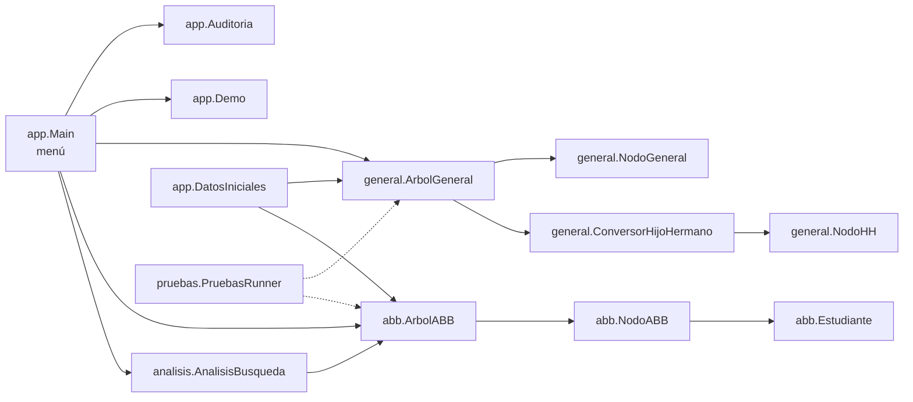
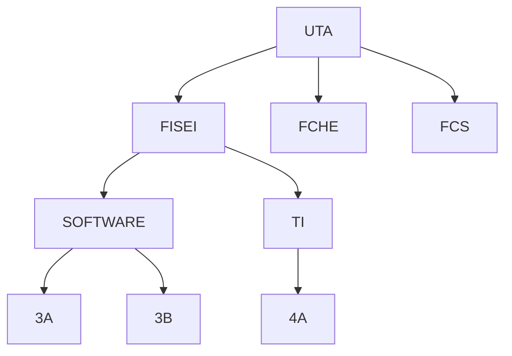
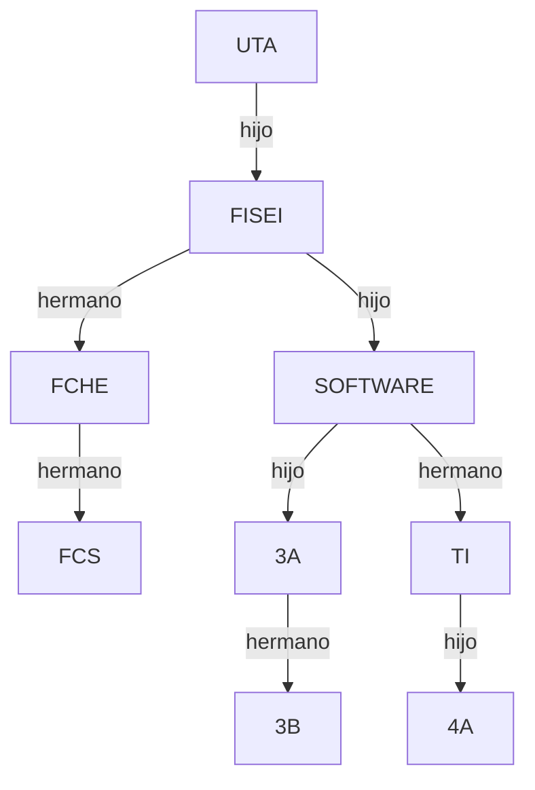
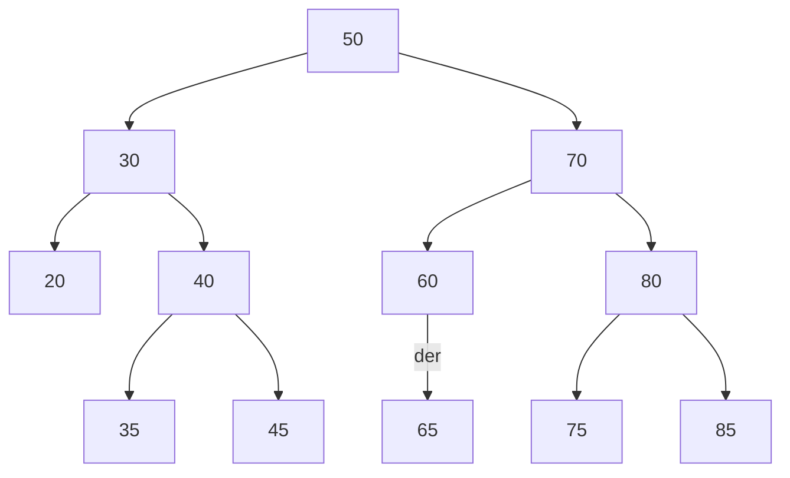
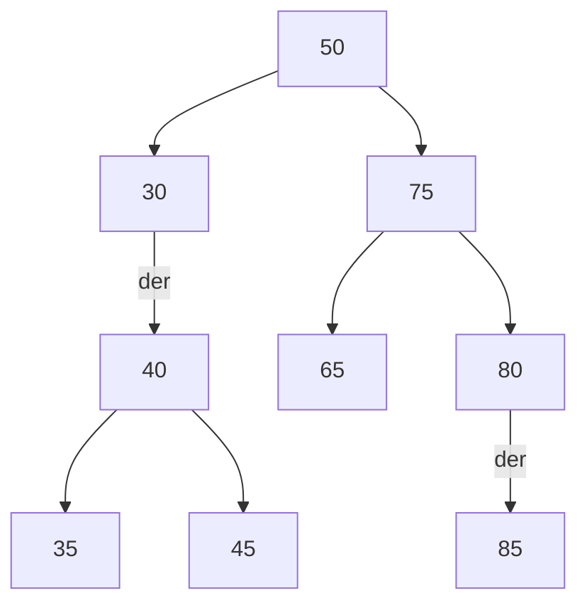

# Diagramas breves

## Arquitectura modular

## Árbol general inicial

## Forma hijo-izquierdo / hermano-derecho

## ABB tras las 12 inserciones (altura 3, 6 hojas)

## ABB tras eliminar 20 (hoja), 60 (un hijo) y 70 (dos hijos, sucesor 75) — 9 nodos, altura 3, 4 hojas

Preorden en cada paso: tras 20 `50, 30, 40, 35, 45, 70, 60, 65, 80, 75, 85`; tras 60 `50, 30, 40, 35, 45, 70, 65, 80, 75, 85`; tras 70 `50, 30, 40, 35, 45, 75, 65, 80, 85`.
